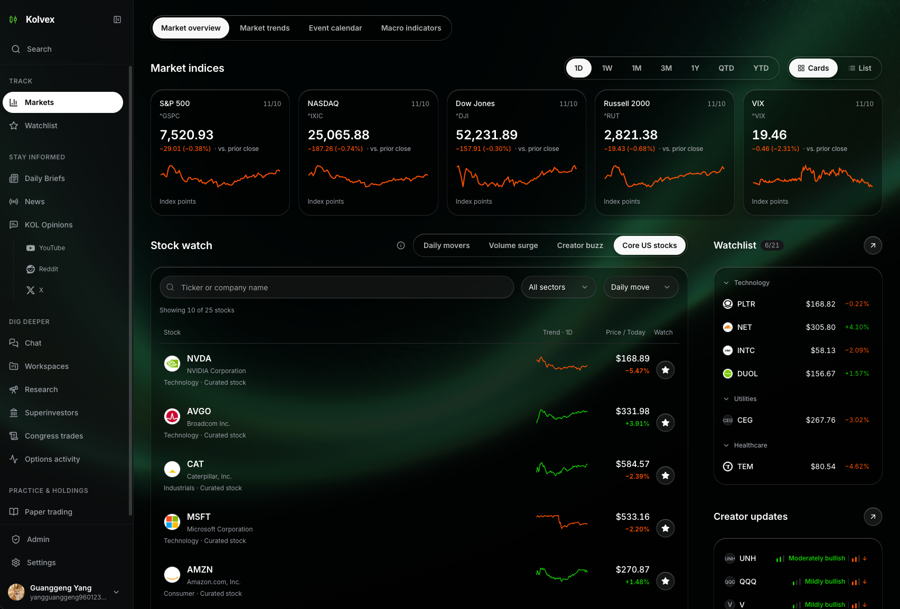
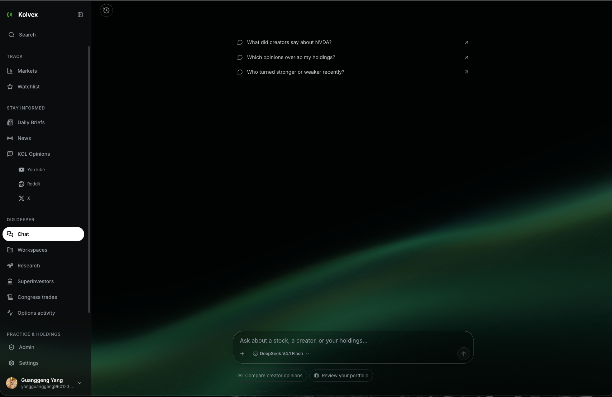

# Kolvex

**English** · [简体中文](./README.zh-CN.md)

Kolvex is an open-source platform for researching U.S. stocks. Compare YouTube creators’ views on a stock, check the date of each view, and follow it back to the original video. You can also read published AI research reports.

[Try the MSFT demo without an account](https://kolvex.app/stocks/MSFT) · [Run locally](#run-locally) · [Star on GitHub](https://github.com/younggg96/kolvex)



## Features

| Module | What you can do |
| --- | --- |
| YouTube stock views | Filter by ticker, creator, sentiment, and date. Browse creator profiles, stock and creator summaries, and changes in daily views. Admins can validate and import individual or batched JSON records. |
| X creator posts | Browse creator profiles and original posts, with ticker filters and pagination. Admins can validate JSON imports and remove duplicates. A scheduled local browser workflow collects new posts hourly. |
| Market data | Look up quotes individually or in batches, historical and intraday prices, company details, financial metrics and statements, dividends, analyst ratings, earnings, and options expirations and chains. |
| Portfolios | Connect investment accounts through Plaid and sync accounts, holdings, and transactions. Manage public sharing and holdings visibility. Review historical snapshots of portfolio value and profit or loss. |
| AI portfolio analysis | Use Ollama to review risk, diversification, strengths and weaknesses, potential adjustments, and individual holdings. |
| AI financial assistant | Save conversations, stream replies, and switch models. The LangGraph assistant can use market data, web search, personal holdings, and trade analysis tools. |
| Multi-agent research | Run market, news, social, and fundamental analysis with bull and bear debates and a risk review. Follow runs in real time, revisit past reports, and publish or unpublish them. |
| Accounts and administration | Use Supabase Auth for sign-up, sign-in, OAuth, and password management. Set a profile, avatar, theme, language, and personal model API key. Admins can view user and data statistics. |

Kolvex imports YouTube analysis generated externally as structured JSON. Multi-agent research produces reports and recommendations. Order execution falls outside this workflow.

The Next.js server also proxies backend requests, caches quotes, aggregates indices, translates text, proxies images, and supports a chat endpoint that connects directly to Ollama.

### AI Chat



## Project structure and stack

The [mobile app](./kolvex-mobile/README.md) uses React Native, Expo, native navigation, and iOS Liquid Glass. It supports account sign-in, synced watchlists, creator content, stock pages, daily briefs, research reports, news, streaming AI chat, and viewing existing brokerage holdings. See the [mobile migration tracker](./kolvex-mobile/MIGRATION.md) for the status of native brokerage authorization and advanced charts. The app labels demo quotes when no API is configured.

```text
kolvex/
├── kolvex-frontend-web-nextjs/   # Next.js 14, React 18, TypeScript, Tailwind CSS
├── kolvex-mobile/               # React Native, Expo
└── kolvex-backend-py/            # FastAPI, Pydantic, Supabase, Redis
    ├── app/api/routes/          # HTTP API
    ├── app/services/            # Market data, Plaid, creator views, chat, and analysis
    ├── app/agent/               # LangGraph assistant and tools
    ├── tradingagents/          # Multi-agent research
    ├── migrations/             # SQL migrations
    └── tests/                  # Backend tests
```

Supabase handles authentication and most application data. Market data comes from yfinance, brokerage connections from Plaid, and web search from Tavily. AI features use hosted models or Ollama. The backend also retains SQLAlchemy, Alembic, and a local PostgreSQL configuration.

## Run locally

The web app requires Node.js 18.17+, Python 3.11+, and a configured Supabase project. Redis supports caching and research progress updates. Ollama supports features that run local models. See the [mobile README](./kolvex-mobile/README.md) for mobile setup.

Admins can also use the [content management MCP server](docs/mcp-content-admin.md) to read and edit daily briefs, YouTube creators and views, and market events over stdio or Streamable HTTP.

### Backend

```bash
cd kolvex-backend-py
python3 -m venv venv
source venv/bin/activate
pip install -r requirements.txt
cp .env.example .env
```

Set `SUPABASE_URL`, `SUPABASE_KEY`, `SUPABASE_SERVICE_KEY`, and a randomly generated `SECRET_KEY` in `.env`. The example file contains some legacy settings. See the [backend README](./kolvex-backend-py/README.md) for current configuration and optional model, Plaid, and Redis credentials. Keep the Supabase service key on the backend.

```bash
python main.py
```

The API runs at `http://localhost:8080`, with interactive docs at `/docs` and a health check at `/health`.

### Web frontend

```bash
cd kolvex-frontend-web-nextjs
npm ci
```

Create `.env.local` with the public Supabase settings and the backend URL.

```dotenv
NEXT_PUBLIC_SUPABASE_URL=https://your-project.supabase.co
NEXT_PUBLIC_SUPABASE_ANON_KEY=your-supabase-anon-key
NEXT_PUBLIC_BACKEND_API_URL=http://127.0.0.1:8080
```

```bash
npm run dev
```

Open `http://localhost:3000`.

### Docker development environment

After configuring the backend `.env`, start the development stack.

```bash
cd kolvex-backend-py
docker compose up -d --build
docker compose logs -f backend
```

Compose starts the backend on port `8080`, Redis, and a local PostgreSQL instance. Configure Supabase separately. Ollama defaults to `host.docker.internal:11434` to connect to the host.

## Retired features

Retired integrations and workflows include direct Robinhood and IBKR connections, the old Twitter and Xiaohongshu creator trackers, the standalone news aggregator, superinvestor holdings, strategy backtesting, stock tracking, following other users, scheduled alerts and notifications, and the previous options activity and standalone options AI features. Contact form email delivery is disabled. Standard options chains and Plaid portfolios remain available.

The current X integration uses its own tables and import flow, with a scheduled local browser workflow to collect posts. See the [X content documentation](./docs/x-content.md) for setup and data formats.

The backend `migrations/` directory includes historical removal scripts. The deployment’s configuration and applied migrations determine which services are available.

## License

[MIT](./LICENSE)
