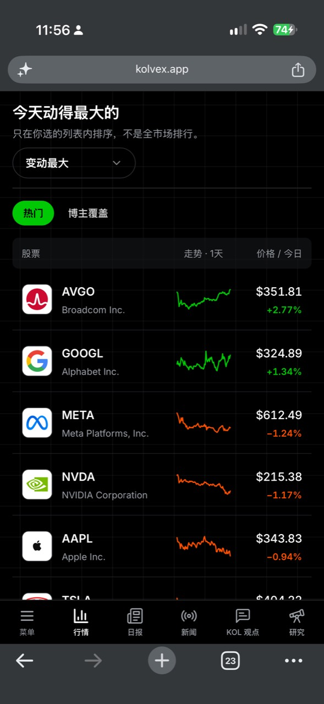

# Kolvex 行情股票列表产品评审

日期：2026-10-29。使用 Product Design / Audit 的任务、信息架构、信任、默认状态与下一步行动视角。

## 范围与证据

本次只评估用户提供的手机股票列表，结合当前仓库判断能力和依赖；未修改产品代码，未验证线上登录后的完整流程，也未取得用户行为数据。



1. 进入列表并扫描股票：基本可用。股票、价格、涨跌易辨识；固定名单和“热门”命名不符，无法看出为何选择这些股票。
2. 选择股票范围或排序：结构有基础，语义需要调整。截图有热门、博主覆盖及变动排序。当前代码的标题固定为“今天动得最大的”，切换涨幅、跌幅、列表顺序后不会相应变化。实际点击行为本次未验证。
3. 从股票继续研究：当前代码有股票详情链接；手机隐藏博主共识列。用户在列表上无法判断某只股票是否有近期、可读的观点证据。详情中的自动定位、返回与阅读状态未实测。
4. 线上补充检查：受阻。https://kolvex.app/dashboard 跳转登录页，未继续登录。报告不据此宣称完成线上流程审计。

## 核心判断

这个区域最合适的任务是：让用户先掌握所选股票范围的价格表现，再识别有新观点值得继续阅读的股票。

现有产品定位强调博主与股票之间可追溯、随时间变化的观点记录。列表应该保留行情的扫描效率，并把这些记录变成下一步入口。

上一轮建议把核心股票、自选、主题、事件作为扩展方向；本轮收窄优先级。数量增加本身不能证明价值，自选需要新增完整能力，主题和事件也不宜全部成为同一级标签。

## 主要发现

| 优先级 | 发现与证据 | 对用户的影响 | 建议 |
|---|---|---|---|
| 高 | Market.tsx 的 DEFAULT_STOCKS 固定为八只科技相关大公司 | 固定名单被理解为动态热门，重复访问缺少发现感 | 改名“常看美股”，说明平台维护；按行业补充覆盖 |
| 高 | 手机端用 hidden sm:block 隐藏博主共识 | 产品的观点数据在手机扫描阶段不可见 | 股票身份下面增加一条来源明确的近期观点线索 |
| 高 | 标题描述波动最大，但排序还可选择涨幅、跌幅和列表顺序 | 标题与当前任务可能不一致 | 使用稳定标题“股票观察”，让排序控件描述排列规则 |
| 中 | “博主覆盖”选出所有覆盖股票，仍默认按今日绝对涨跌排序 | 用户不知道最近谁在讨论什么 | 在这个范围内提供近期讨论、最新观点等排列方式 |
| 中 | 标题、长说明、排序、分隔线和范围按钮先于数据 | 手机查看股票前需要扫描较多控制信息 | 把范围放在排序前，缩短范围说明；排序靠近列表 |
| 中 | 个股走势图分别归一化 | 相似曲线的幅度容易被误读为可横向比较 | 数字涨跌承担幅度比较，曲线用于形状浏览 |

## 三种方向的取舍

| 方向 | 服务的用户任务 | 代价与依赖 | 决策 |
|---|---|---|---|
| 扩展行情目录 | 查看更多股票、行业和涨跌 | 需要维护名单、分类、报价；全市场榜单另需完整市场股票池和筛选服务 | 做有限范围的基础能力 |
| 行情连接观点线索 | 从价格变化进入近期博主证据 | 已有讨论量、分布和来源；还需确认近期数据是否足够活跃 | 推荐作为本轮重点 |
| 个人关注中心 | 每天跟踪自己关心的股票 | 自选的增删、持久化、跨端同步、空状态均需新增 | 后续独立迭代 |

现有项目停用了股票筛选器和持仓入口。本轮不把恢复这些功能当作必要条件，也不能把固定名单内排序称为全市场排行。

## 推荐首版结构

保留“行情”主导航，调整这个模块为“股票观察”。已有页面顶部搜索继续复用。

```text
股票观察

常看美股        博主关注

[当前范围的筛选]              排序 ▾

股票 / 近期线索       小走势       价格 / 今日
```

“常看美股”先用跨行业、可维护的观察名单。20–30 只是便于验证的初始假设，最终数量应取决于覆盖和加载表现。行业作为此范围内的筛选，避免把金融、科技、自选、财报等不同概念混成一排标签。默认按今日绝对涨跌排序，明确“名单内排序”；排序项使用今日波动、涨幅优先、跌幅优先。当前首屏先展示约 8–10 行，再明确加载更多。

“博主关注”服务股票发现，主对象仍是股票；完整博主观点页负责找博主、看历史和做深入筛选。默认按近 7 天观点条数排序，排除该窗口内没有观点的股票。次级选项可提供最新观点；“观点分歧”先验证样本，再决定是否上线。

新用户先进入常看美股；回访恢复之前选择。不要在行情请求刷新时让正在阅读的行持续重排；完成刷新后再统一更新顺序。

## 每行应该展示什么

保留股票代码、公司名称、价格、带正负号的涨跌。手机将一条短观点线索放在身份区域下方，保持整行能进入股票详情。走势图有空间就保留；窄屏优先保证股票和观点线索完整可读。

线索按当前范围选择，不把所有字段堆在一行：

- 常看美股：有近期观点时显示其日期和简短来源入口；没有则保持普通行情行。
- 近期讨论：显示“近 7 天 · N 条观点”。N 必须来自真实数据，不能写成 N 位博主。
- 最新观点：显示实际发布时间、作者和简短方向；缺失发布时间不能用导入时间冒充。
- 观点分歧：显示近 30 天最新博主方向分布及样本数；每位博主只计最新一条。

从观点线索进入详情应定位到相关观点区域；从行的主要区域进入股票详情默认图表。实现时二者使用独立可访问链接，避免嵌套点击目标。列表返回应保留范围、排序和滚动位置。

## 数据含义与上线条件

当前接口已经定义：近 7 天观点条数、此前 7 天条数、近 30 天博主最新方向分布、最近证据与来源链接。这是代码能力，不能直接证明线上数据数量、及时性和覆盖率足够。

- 近 7 天讨论量统计的是观点记录，不是去重博主数，也不是全市场热度。
- 历史 creator_count 不能直接叫作本周讨论人数。
- 聚合平均分变化不代表某位博主改变立场。首版不推出未经逐人历史对比的“博主转多/转空”。
- 分歧不是简单的平均分接近中性。可以先以“近 30 天至少 4 位博主，看多与看空各占至少 25%”作为待验证规则，始终显示样本量；数据不足就不推出榜单。
- 最新证据需先检查发布时间缺失时的排序口径，避免旧视频因为新导入而进入“最新观点”。
- 社区热议可以后续复用 Reddit 数据作为第三个股票范围。须标注 Reddit、24 小时提及次数和采集时间；不与 YouTube 的七天观点数直接相加。
- 财报和新闻已经有各自页面；这里未来只展示股票相关入口，不复制一整套新闻流。

## 空状态、错误与可访问性

近 7 天无观点时解释当前窗口内没有更新，提供查看历史或切回常看美股；接口错误单独显示重试。刷新失败保留上次数据和时间；无报价用破折号，不显示 0%。

截图中的涨跌有数字和正负号，这是可保留的优点；暗色细网格穿过表格会分散注意力，可降低数据区背景纹理。灰色小字对比、触摸目标、键盘焦点和屏幕阅读器需要实测，不能只凭截图宣称通过。股票、观点线索和展开动作若分开，应各自有清楚标签和足够触摸面积。

## 版本顺序与验证

第一步：命名与范围清楚、补齐跨行业观察名单、手机恢复观点线索、修正标题与排序关系。第二步：博主关注的近期排序和详情定位。第三步：根据使用证据选择社区热议或自选；主题、财报留作范围内筛选或行内线索。

先记录现有列表基线，再比较：列表曝光后进入股票详情的比例、进入观点并打开原始来源的比例、每个会话探索的不同股票数、回访使用情况。辅助检查列表到达时间、报价完整率、错误率。单纯点击排序更多、停留更久或浏览股票更多，都不能单独证明体验改善。

下一步最有价值的验证：抽样最近两周实际导入的数据，检查“近期讨论 / 最新观点 / 观点分歧”各能产生多少有效股票，再决定哪些入口值得进入首版。

## 当前代码依据

- `kolvex-frontend-web-nextjs/PRODUCT.md`：定位、产品职责、退役功能。
- `kolvex-frontend-web-nextjs/components/decision/Market.tsx`：固定股票池、排序、范围和手机字段。
- `kolvex-frontend-web-nextjs/lib/productFeatures.ts`：持仓未开放。
- `kolvex-frontend-web-nextjs/lib/youtubeOpinionsApi.ts`：观点聚合契约。
- `kolvex-backend-py/app/services/youtube_stock_opinions.py`：七天讨论、三十天分布、最新证据的计算。
- `docs/decision-workspace.md`：观点变化与 Reddit 数据的含义。
